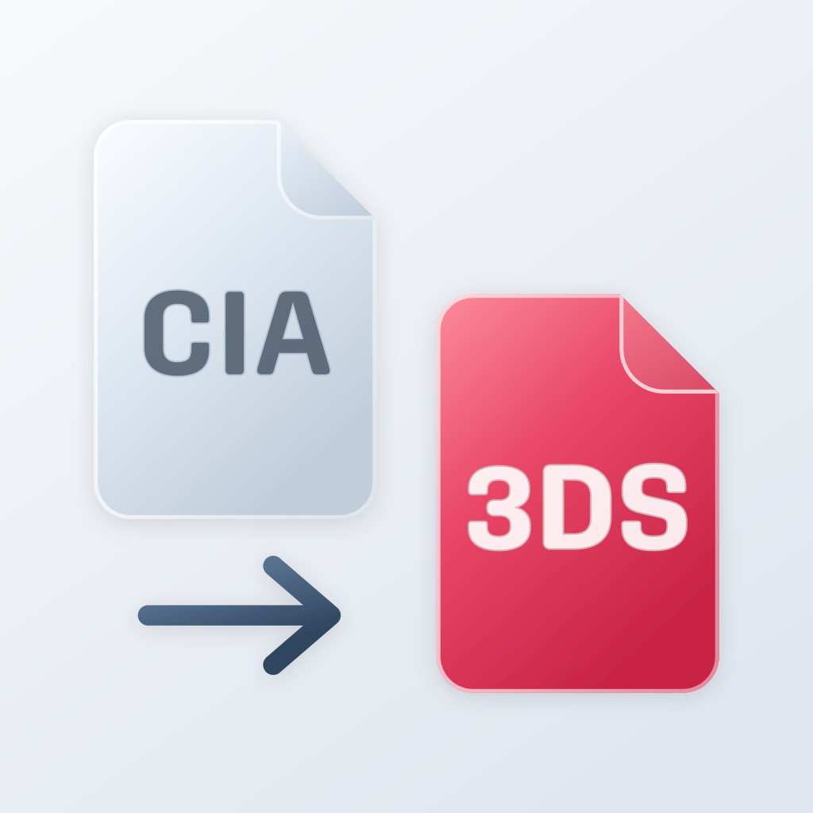

<div align="center">



# CIA Decrypter for iOS

</div>

Convert Nintendo 3DS CIA files into decrypted `.3ds` files on your iPhone or iPad. Choose one or more games, convert on your device, and save the results to Files for your emulator. Bring your own CIA files and decryption keys.

<a href="https://altstore.io/source/github.com/nickesc/cia-decrypter-ios/releases/latest/download/source.json?app=com.nickesc.ciadecrypter">
  
</a>

## Install

Install and update through **AltStore Classic** on an iPhone or iPad running **iOS 26 or later**.

1. [Set up AltStore Classic](https://faq.altstore.io/altstore-classic) if you don't have it.
2. Open AltStore's **Browse** tab, open **Sources**, and add the source URL below.
3. Find **CIA Decrypter for iOS** in the source and install it.

```text
https://github.com/nickesc/cia-decrypter-ios/releases/latest/download/source.json
```

Keep the source added to get future updates through AltStore. Use AltStore's **My Apps** tab to refresh your installation when needed. See the [AltStore guide](https://faq.altstore.io/altstore-classic/your-altstore) for help.

For manual sideloading with AltStore or LiveContainer, download `CIADecrypter.ipa` from the [latest release](https://github.com/nickesc/cia-decrypter-ios/releases/latest).

## Usage

1. Open **Keys** and import the [key files](#key-files) your game needs.
2. Tap **Add CIA files** and select one or more `.cia` files.
3. Use **Save to Files** or **Share** on a ready result. When the queue finishes or pauses, use **Save All** or **Share All** to export all remaining results.
4. Import the `.3ds` files into your emulator.

For now, use **base-game CIAs** only. The app does not yet support updates, DLC, or system titles.

## Key files

Import files from **Keys** once and reuse them for future conversions. You can replace or remove them from the same screen.

| File           | Purpose                                                                                   |
| -------------- | ----------------------------------------------------------------------------------------- |
| `aes_keys.txt` | Keys for encrypted games.                                                                 |
| `seeddb.bin`   | Title seeds required by some games.                                                       |
| `boot9.bin`    | Keys from your full or protected retail Boot9 dump. Some games still need `aes_keys.txt`. |

If a conversion reports a missing key or seed, import the required file, then tap **Redo**.

## Troubleshooting

| Situation                            | Next step                                                                         |
| ------------------------------------ | --------------------------------------------------------------------------------- |
| Low storage                          | Free space, then resume. Save ready results to free up the app's working storage. |
| Missing keys or a failed file        | Fix the reported cause and tap **Redo**. Other files can continue.                |
| Paused or interrupted conversion     | Reopen the app and resume.                                                        |
| Source moved or Files access expired | Select the CIA again through Files.                                               |

If you use LiveContainer and run into background or file-picker issues, try its per-app **Fix Background Processing Tasks** and **Fix File Picker** settings.

## For developers

<details>

<summary>Expand to see development information</summary>

Open `CIADecrypter.xcodeproj` in **Xcode 26 or later**, select your signing team, and run the **CIADecrypter** scheme. To package an unsigned IPA, install [XcodeGen](https://github.com/yonaskolb/XcodeGen) and run `bash Scripts/build-ipa.sh`.

Run `swift test` for the conversion core and `python3 -m unittest discover -s Tests/Python` for release metadata. See [verification notes](VERIFICATION.md) for test results and remaining device checks, and the [release workflow](.github/workflows/release.yml) for IPA and AltStore source publishing.

</details>

## License

This project uses the [MIT License](LICENSE).
